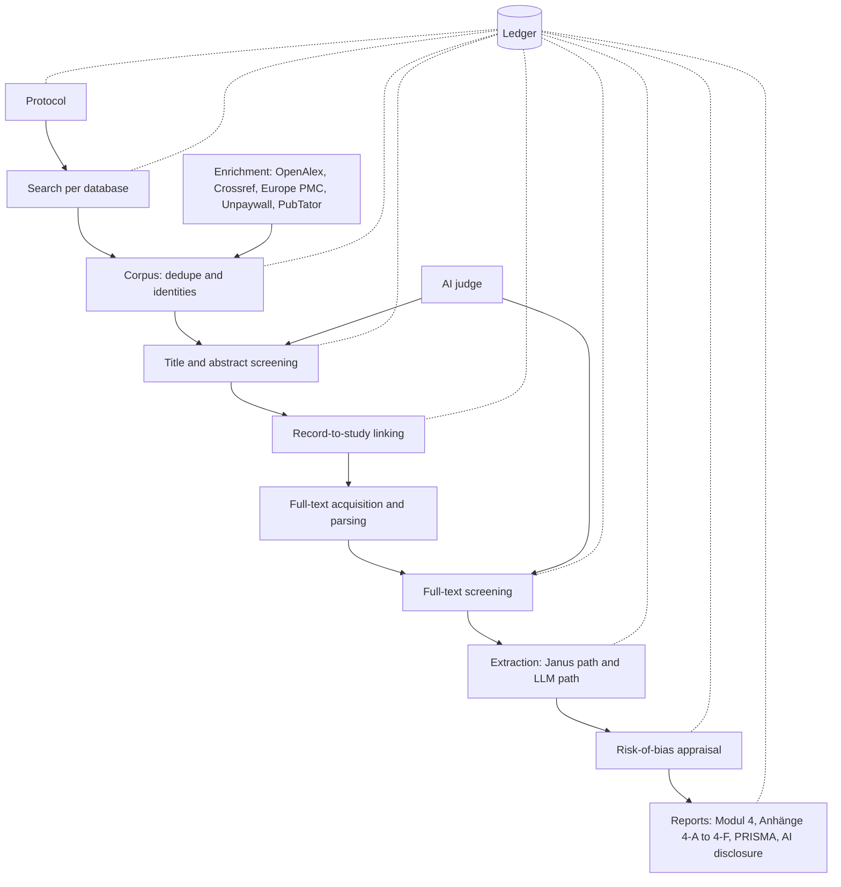

# How Kittum works

This document explains the design of Kittum, a workbench for the systematic literature review
(SLR) inside a G-BA benefit dossier. It is written for an engineer who knows LLMs but not German
health technology assessment (HTA). The supporting reference pages are:

- [Sources](docs/sources.md) for search and enrichment sources.
- [Document and model tools](docs/document-tools.md) for parsers, OCR, and models.
- [Requirements and standards](docs/requirements.md) for the regulatory mapping.

## The problem in one page

A pharmaceutical company that launches a drug in Germany submits a dossier to the Federal Joint
Committee (G-BA). The Institute for Quality and Efficiency in Health Care (IQWiG) then assesses it.
Modul 4 of the dossier must show the complete evidence for the drug against the comparator the
G-BA chose, the *zweckmäßige Vergleichstherapie* (zVT). Completeness is checked: IQWiG reruns
searches and spot-checks the studies the company excluded. A missed study can sink the assessment.

The review follows a fixed shape:

1. A protocol states the population, intervention, comparator, outcomes, and study types (PICO)
   for each subpopulation. One dossier can have several *Anwendungsgebiete* (therapeutic
   indications), each with subpopulations and its own zVT.
2. A search specialist runs one Boolean search per database. The minimum is MEDLINE and Cochrane
   CENTRAL, plus the registries ClinicalTrials.gov, EU-CTR, CTIS, and the EMA Clinical Data portal.
3. Two people screen titles and abstracts independently, then full texts. They resolve
   disagreements and record a reason for every full-text exclusion.
4. Records are grouped into studies. One trial typically appears as a paper, follow-up papers,
   congress abstracts, registry entries, and a clinical study report (CSR).
5. Reviewers extract results per study, endpoint, subpopulation, arm, and timepoint, and assess
   risk of bias on the G-BA form.
6. The output is the Modul 4 text and tables, Anhänge 4-A to 4-F, and RIS files in a directory tree
   whose names Anlage II.1 fixes.

Searches must be at most three months old at submission, so every review ends with an update
search. Since January 2025 the EU HTA Regulation adds joint clinical assessments (JCA). These
arrive with several PICOs that member states consolidate, often late.

## Where the value is

The seed brief's thesis holds: the pipeline is commodity, and the evidence layer is the product.
Inference costs little next to reviewer time, so Kittum spends compute on recall and on
verification, not on picking the cheapest model. Three corrections change what "evidence layer"
means in practice.

**The unit of inclusion is the study, not the record.** Modul 4 asks how many studies the relevant
records belong to. Kittum keeps search records, reports, studies, and PDF files as separate
identities, and a human confirms each record-to-study link.

**A decision belongs to a record within a scope.** A scope is a search topic, subpopulation, or JCA
PICO. When a new JCA PICO arrives, Kittum evaluates only the new criteria over the screened corpus.
It does not rescreen everything.

**Recall cannot be certified statistically at AMNOG scale.** Most search topics have tens of
relevant records. If all 10 relevant records of a topic are found, the one-sided 95% lower confidence
bound on recall is 74%. A miss rate below 2.5% at the same level needs at least 119 relevant
records with no misses. (Kittum states every bound as one-sided 95% Clopper-Pearson.) The
honest pitch for AI screening is that it finds studies humans miss. It is not that it cuts the
human reading load on submission-critical topics. Workload savings are real only for large
searches, such as indirect comparisons or JCA sweeps.

## Screening modes

IQWiG's methods (v8.0, §9.1.1) require two people to perform every selection step independently.
Modul 4 §4.2.3.5 asks the company to justify any other procedure. IQWiG v8.0 also states for the
first time that AI in study selection is possible, if the tool's suitability is shown against
RAISE. So the protocol declares a screening mode per search topic before screening starts, and
Kittum writes the matching §4.2.3.5 justification from the ledger.

| Mode | Human work | AI role | Use when |
| --- | --- | --- | --- |
| M1 dual human, AI as third reader (default) | Two humans screen every record. | Independent third screener. A record that the AI includes and both humans exclude goes to adjudication. | Every submission-critical topic. |
| M2 single human, AI as second reader | One human screens every record. | Replaces the second human. Disagreements go to adjudication. | Large topics, after a validation pack shows the AI's performance on pooled gold data. |
| M3 prioritized dual screening with a certified stop | Humans screen in AI order and stop when a pre-specified statistical test passes. | Ranking only. | Topics with roughly 10,000 records and 100 expected relevant records. Rare in AMNOG. |

No mode lets the AI exclude a record that no human saw. Changing the mode mid-topic creates a new
protocol version with a logged reason.

## The pipeline



Each stage reads frozen inputs and writes new revisions. Nothing edits a previous revision.

### Protocol

The protocol is the source of truth for every later decision. It is versioned JSON with a content
hash. Kittum publishes it only with a recorded approval.

```text
Dossier(active_substance, trade_name, version)
	Anwendungsgebiet(code)
		Teilpopulation(id, definition, G-BA consultation reference)
			zVT(options, "nach ärztlicher Maßgabe" flag, source document, qualifying comparator arms)
			jca_pico_links[]
		Endpoint(category: Mortalität | Morbidität | Lebensqualität | Nebenwirkungen,
			operationalization, patient-relevance rationale, surrogate validation reference)
		EffectModifier[] (default: sex, age, disease severity, centre or country)
		SearchTopic(kind: RCT with the drug | RCT for indirect comparison | non-randomized | other)
			Criterion[] (id, PICO slot, polarity, text_de, text_en, positive and negative examples,
				decidable_at: title-abstract | full-text | both, applies_to: scopes)
			SourcePlan (databases, registries, G-BA website search, justified deviations)
			ReferenceSet (development and validation known-includes, PRESS record)
			ScreeningMode (M1 | M2 | M3) with AuditPlan and StoppingPlan
			FreshnessPolicy (maximum age three months before submission)
```

Criteria are executable. Each criterion compiles to a question that a human answers with a key
and that the AI judge answers as `met`, `not_met`, or `unclear` with a quote. Exclusion reasons are
criterion IDs, so Anhang 4-C and 4-D reasons come from data instead of free text.

### Search

The documented primary search is Boolean, one strategy per database per topic, as PRISMA-S and
Modul 4 require. Kittum never documents vector search or federated search as primary search.

Each search run becomes a `SearchExecution`: the database, the platform, the verbatim strategy, the
platform's own query translation (PubMed returns it), limits, coverage, UTC start and end, the
reported hit count, the retrieved count, and the raw response bytes. An incomplete execution cannot
close screening.

Two adapters sit behind the search seam from day one:

- `LiveApi` for PubMed E-utilities and ClinicalTrials.gov v2.
- `FileImport` for RIS, NBIB, XML, and CSV exports, together with a captured copy of the search
  history. CENTRAL, Embase, EU-CTR, and CTIS have no free search interface, so the free proof of
  concept cannot meet the Modul 4 minimum without this adapter.

Commercial interfaces (Embase, Scopus, Web of Science) become further `LiveApi` adapters when a
contract grants automated access. A subscription does not imply that grant.

An update search reruns the same strategies. Kittum diffs the result against the earlier execution
by identifier and by content: new records go to screening, and records whose content changed
under the same identifier (a registry entry that now posts results, a corrected abstract) go to
review. Both runs appear in the PRISMA flow.

### Enrichment and federation

Federation is where Kittum combines free sources and spreads load. It applies to enrichment only:
filling missing abstracts, resolving DOIs, finding open-access PDFs, checking retractions, tagging
entities, and citation chasing. Any of several sources can answer a lookup by DOI or PMID, so a
per-source token bucket and a "first healthy source" policy spread the calls. Every HTTP response is
cached by request hash, so replaying an execution works offline. A new execution of the same
query bypasses the cache.

Enrichment never adds records to identification counts. Citation chasing creates a separate
`SearchExecution` of kind `other_methods`, which PRISMA 2020 reports in its own column. Kittum never
rotates keys or accounts to get around quotas.

[Sources](docs/sources.md) lists every source, its limits, and its licence for commercial use.

### Corpus and identities

Deduplication of records matches on report identifiers (DOI, PMID) first, then on fuzzy title,
author, journal, and year. Trial identifiers (NCT, EudraCT, CTIS numbers) never merge records: a
primary paper, a follow-up, and a subgroup analysis share them. They drive study-link proposals
instead. Kittum keeps every source occurrence even after merging, because Anhang
4-A counts all hits per database and Anhang 4-D requires an undeduplicated RIS file.

Identity is versioned. An `IdentityRevision` records which occurrences belong to which report and
which reports belong to which study. A human confirms record-to-study links, and the
confirmations are ledger events. PRISMA counts come from a frozen identity revision.

### Screening and the AI judge

The AI judge answers each criterion for each record:

```json
{
	"criterion_id": "C_POP_ADULT_NSCLC",
	"status": "not_met",
	"quote": "patients aged 12 to 17 years",
	"rationale": "The trial enrolled adolescents only."
}
```

The AI excludes a record only when three conditions hold:

1. At least one criterion is `not_met`.
2. The quote appears verbatim in the record. A deterministic check confirms the match.
3. The quote passes the criterion's keyword and negation checks.

If any check fails, the criterion becomes `unclear`. At title and abstract, `unclear` means include.
IQWiG excludes at title and abstract only records that are certainly irrelevant, so this rule
matches the method.

The PoC runs the judge on every record. A topic of 3,000 records costs a few thousand model calls,
which is cheap enough to skip the seed brief's ranker cascade. That cascade used BM25, dense
embeddings, a cross-encoder, and active learning. A ranker returns later as an adapter for
Embase-scale topics, and only to order the queue.

Two model families run as independent judges. A third family is an experiment. Kittum keeps a judge
only if it finds relevant records that the others miss. Kittum measures how often judges miss the
same records (the double-fault rate) on gold data. Disagreement routes records to adjudication and
into the audit census stratum. Kittum never reports disagreement as a probability.

Model-stated confidence is not calibration. Kittum calibrates per project on a random,
human-labelled sample. M1 produces that sample anyway.

### Full text

Full texts come from a waterfall: the local content store, Europe PMC full-text XML, Unpaywall and
OpenAlex open-access locations, publisher text-and-data-mining (TDM) interfaces under licence, and
finally a human upload queue for closed-access articles and client CSRs.

Full-text screening has three outcomes: include, exclude, and insufficient information. Every
outcome cites an evidence span. "Insufficient information" covers missing data, an author query,
or a CSR request. It prevents false exclusions.

### Extraction

Extraction has two independent paths that meet in reconciliation.

- **Janus path (deterministic).** Janus locators find tables and labelled values in the parsed
  document. They extract N, events, effect estimates, confidence intervals, p-values, doses, and
  durations, with typed decimal parsing. Janus works best on CSRs, whose section 14 tables follow
  sponsor templates. One Janus specification per sponsor template is reusable across studies.
- **LLM path (agent-driven).** A bounded agent reads the parsed document through read-only tools:
  search the text, open a table, read a page. It has a call budget and a time budget. It returns
  typed values with verbatim quotes. A deterministic verifier resolves each quote to a span in the
  parsed text. The model never supplies trusted offsets. Kittum treats instructions inside a
  document as untrusted data.

Each extracted value is keyed by study, report, subpopulation, analysis set, data cut, arm, endpoint,
and timepoint. JSON pointers and array indexes are display addresses, not identity across runs.

Validators run on both paths:

- Events are at most N.
- Arms sum to the total.
- The confidence interval brackets the estimate.
- Percentages recompute from counts. A mismatch often reveals an ITT and safety population swap.
- Ratio estimates are symmetric on the log scale.

Each field in the extraction schema has a verification policy:

| Policy | Fields | Gate |
| --- | --- | --- |
| `critical` | N randomized and analysed, events, effect estimates, CI bounds, p-values, follow-up for Modul 4 results | A human always verifies against the highlighted source. When the paths disagree, a second human extracts independently. |
| `standard` | Baseline characteristics, doses, durations | A human may accept agreeing, validated fields as a group after viewing the list. A random 10% go to a re-check queue. |
| `descriptive` | Population descriptions, prior therapy, endpoint definitions | One human reviews the LLM value and its span. |

Every accepted value carries an evidence anchor or a reviewed grounding exception. An example is a
value read from a Kaplan-Meier figure with no text span. Missing, ambiguous, and invalid values stay
visible.

### Appraisal

Modul 4 rates risk of bias as *niedrig* (low) or *hoch* (high), at study level (Tabelle 4-9) and per
endpoint (Tabelle 4-12). Anhang 4-F holds one *Bewertungsbogen* (assessment form) per study.
JCA uses RoB 2 and ROBINS-I V2. Kittum stores the forms as data. The AI assembles quotes for each
signalling question and never judges. A named human answers, and Kittum renders the answers onto
every instrument the dossier needs.

Certainty of evidence follows IQWiG's scale of *Beleg*, *Hinweis*, and *Anhaltspunkt* (proof,
indication, hint), not GRADE.

### Reports

Kittum renders every report from the ledger. Nobody types counts.

- Modul 4 sections 4.2 and 4.3: the method text, including the §4.2.3.5 justification for the
  screening mode, and the results tables per endpoint and subgroup.
- Anhang 4-A (bibliographic strategies), 4-B (registry strategies), 4-C (full-text exclusions with
  reasons), 4-D (excluded registry entries with reasons), 4-E (methods of included RCTs), and 4-F
  (risk-of-bias forms).
- The Anlage II.1 directory tree with its exact RIS file names.
- The PRISMA 2020 flow per scope, the PRISMA-S table, and an AI-use disclosure.
- A validation pack for client vendor audits.

The AI-use disclosure is data first. The PRISMA executive does not endorse PRISMA-trAIce, and RAISE
is still changing, so Kittum renders the same disclosure record into whichever template a client
needs. Typst output can go through Nisaba later, behind a versioned template adapter.

## Modules

The system is a Python modular monolith with durable workers and a TypeScript reviewer workbench.
Each module below is deep: callers learn a small interface, and the module hides a lot of
behaviour. A module gets an external seam only where two adapters exist. A single adapter is a
hypothetical seam, so Kittum does not add a port for it.

| Module | Interface | Hides | Adapters at the seam |
| --- | --- | --- | --- |
| `protocol` | `compile(source) -> Protocol`, `diff(a, b) -> ProtocolDiff` | Validation, zVT consistency with Modul 3, criterion rendering for humans and models, versioning | None |
| `search` | `run(plan) -> SearchExecution` | Query dialects, paging, the PubMed 10,000-record cap, retries, raw capture, PRISMA-S fields | `LiveApi` (PubMed, ClinicalTrials.gov), `FileImport` |
| `enrich` | `enrich(records) -> Enrichment` | Source choice, token buckets, response cache, retraction checks | OpenAlex, Crossref, Europe PMC, Unpaywall, PubTator |
| `corpus` | `ingest(executions) -> CorpusRevision`, `link(proposal, receipt) -> IdentityRevision` | Dedupe, record-to-study clustering, occurrence retention | None |
| `judge` | `judge(item, criteria, config) -> Verdict` | Prompts, constrained decoding, quote verification, retries, raw output capture | `LlmBackend`: vLLM, Ollama, EU-hosted API, recorded-response fake |
| `screening` | `next(reviewer, scope)`, `decide(assignment, decision, expected_revision)`, `status(scope)` | Mode rules, blinding, reveal-after-commit, queue order, sentinels, audit sampling, conflicts | None. The workbench is a thin client of this module. |
| `documents` | `derive(document, recipe) -> Layer`, `resolve(anchor, layer) -> Resolution` | Acquisition, parsing, OCR fallback, coordinate frames, text maps, re-anchoring | `Parser`: PyMuPDF, pypdfium2, Docling, GROBID |
| `extraction` | `extract(layer, field_specs) -> ProposalSet` | Janus path, LLM path, validators, reconciliation | Janus and the LLM agent |
| `appraisal` | `draft(study, instrument) -> AppraisalDraft` | Quote assembly per signalling question, forms as data | None |
| `stats` | Pure functions: `elusion_estimate`, `stop_test`, `capture_recapture`, `conformal_threshold`, `agreement` | Exact and Bayesian intervals, simulation tests | None |
| `runs` | `run(spec) -> RunRef`, `resume(run)`, `diff(a, b) -> RunDiff` | Job leases, cache keys, manifests, idempotent publication | None |
| `ledger` | `append(event)`, `verify()`, `seal(revision, profile) -> Bundle` | Hash chain, checkpoints, signatures, bundle export | Postgres (live), SQLite (handover and tests) |
| `report` | `render(target, scope) -> Artifact` | Modul 4 and annex layouts, Anlage II.1 naming, PRISMA, disclosure templates | Targets: G-BA, JCA, PRISMA |

The deletion test favours `screening`, `documents`, and `report` most. Without `screening`, the mode
rules and blinding would leak into the UI and every stage. Without `report`, G-BA naming rules would
spread across callers. `runs` stays small on purpose. It is a job table, not an orchestration
framework with its own vocabulary.

Kittum uses no agent framework. Plain Python with Pydantic-validated structured output covers the
judge and the extraction agent. PydanticAI (MIT) is acceptable if a model-agnostic client helps.
LangChain and LangGraph would add a shallow layer over `judge`.

### How Janus fits

Kittum uses Janus as a library dependency, not as a service, and does not absorb it. Kittum calls
`janus.extraction.extract(document, specification)` with a specification generated per endpoint
schema. Janus's pure extract-and-compare split, typed decimal parsing, locators, and field statuses
are what Kittum needs.

Janus reads PDFs with PyMuPDF, which is AGPL-3.0. Kittum is AGPL too, so Janus can be used as it
is. Kittum's own base reader is also PyMuPDF, which means Janus and Kittum see the same text layer.

Kittum maps Janus statuses (`extracted`, `missing`, `ambiguous`, `invalid`, `error`) without
collapsing them. It reuses Janus's UI patterns but not its mutable review storage, which the ledger
replaces.

## Provenance that survives re-parsing

A parser upgrade must never silently move yesterday's evidence. Kittum separates three layers.

1. **The document.** Kittum hashes the original PDF bytes with SHA-256 on ingestion. A revised PDF
   is a different document, even with the same DOI. Two downloads of identical bytes are one
   document with two acquisitions.
2. **The derived layer.** A parser recipe names the engine version, container digest, model
   weights, OCR languages, normalization rules, and configuration. The layer stores raw parser
   output, canonical text, page geometry, the table model, and the normalization map, all
   content-addressed. The same recipe can produce different output, so a layer also has its own
   output hash.
3. **The anchor.** An anchor binds a value to a layer.

```text
Anchor
	document_sha256, layer_sha256, text_sha256
	selectors[]: TextPositionSelector {start, end}
	             TextQuoteSelector {exact, prefix, suffix}
	regions[]: {page_index, polygon, coordinate_frame}
	cell_refs[]: {table_id, row, column, row_span, column_span, header_path}
	grounding_status
```

Selectors follow the W3C Web Annotation model. Offsets are Unicode code points, half-open, over the
layer's canonical text. The browser converts its UTF-16 positions explicitly. Pages use zero-based
physical indexes plus printed labels. Geometry is in unrotated top-left PDF points, as in Janus.
Kittum stores polygons or per-line rectangles. One union rectangle over a two-column paragraph would
highlight unrelated text.

When a new layer arrives, re-anchoring creates mapping records:

1. For the same layer, resolve directly and check the quote hash.
2. For a new layer on the same PDF, search the exact quote with its prefix and suffix, constrained to
   the original page and region. Accept only a unique match.
3. If normalization changed, use the normalization maps and token overlap. Record the method.
4. Fuzzy matches only propose candidates. Repeated phrases, changed numbers, and split tables go to
   a reviewer.
5. For a different PDF, page alignment is a separate document-revision mapping. Matching quotes do
   not carry acceptance across.

A mapping is `exact`, `candidate`, `ambiguous`, `unresolved`, or `reviewer_confirmed`. An accepted
value always renders on its original layer. Re-anchoring is required only when a project promotes
a new parser as its baseline.

## The ledger

### Store

Postgres is the live system of record, with content-addressed object storage for PDFs, raw
responses, and model outputs. Two reviewers and background workers need real concurrency, row
security for blinding, and `SKIP LOCKED` job queues. SQLite is the portable handover format and a
test adapter. DuckDB is optional for analysis over exports.

Kittum stores domain data as relational revisions and writes an audit event in the same transaction.
Screens query normal tables. Kittum does not rebuild every view from an event stream. Projections can
still be rebuilt, because events carry schema versions.

Writes follow the pattern of t3code's orchestrator. A pure decider turns a command into events
without doing any I/O. One transaction then commits the events, the revision rows, the command
receipt, and outbox jobs. Workers run the outbox jobs (a model call, a parse, a search) and feed the
results back as new commands. A retried command finds its receipt and does nothing, so a crash
never writes a decision twice.

### Schema sketch

```text
project(id, name, policy_version, retention_policy_id)
actor(id, identity_ref, kind, organization)
protocol_version(id, project_id, parent_id, content_hash, approved_event_id)
search_execution(id, project_id, protocol_id, source, platform, topic, kind,
	strategy_hash, started_at, ended_at, reported_count, retrieved_count, status)
source_occurrence(id, search_id, provider_record_id, raw_artifact_hash, ordinal)
report(id, project_id)
study(id, project_id)
identity_revision(id, project_id, parent_id, event_id)
identity_link(id, revision_id, occurrence_id, report_id, study_id, relation)
artifact(hash, media_type, bytes, schema_version)
artifact_location(id, hash, object_key, rights_id, retain_until, legal_hold)
document(id, artifact_hash, revision_of_id)
acquisition(id, project_id, document_id, source, acquired_at, rights_id)
layer(id, document_id, recipe_hash, output_hash, run_id)
anchor(id, layer_id, selector_json, geometry_json, cell_refs_json, grounding_status)
anchor_mapping(id, old_anchor_id, new_anchor_id, method_version, status, reviewed_event_id)
verdict(id, item_ref, scope_id, judge_config_id, per_criterion_json, raw_output_hash)
assignment(id, project_id, item_ref, scope_id, stage, reviewer_id, blind_group, kind)
decision(id, assignment_id, protocol_id, phase, outcome, reason_criterion_id,
	evidence_anchor_ids, ai_revealed_at, supersedes_id, event_id)
adjudication(id, decision_ids, final_decision_id)
assertion(id, study_id, report_id, semantic_key, protocol_id, value, unit, status,
	producer_run_id, supersedes_id)
assertion_evidence(assertion_id, anchor_id, role)
derivation(id, output_assertion_id, input_ids, formula_hash, rounding)
acceptance(id, assertion_id, reviewer_id, disposition, event_id)
model_version(id, provider, model_name, weights_hash, tokenizer_hash, licence_id)
prompt_version(id, template_hash, output_schema_hash)
run(id, project_id, parent_id, manifest_hash, status)
stage_attempt(id, run_id, stage_key, attempt, lease_until, request_hash,
	raw_response_hash, output_hash, status)
audit_event(project_id, seq, event_id, type, schema_version, actor_id,
	recorded_at, payload_hash, prev_hash, event_hash)
checkpoint(id, project_id, seq, head_hash, signature, key_id, tsa_token_hash)
export(id, project_id, cutoff_seq, identity_revision_id, manifest_hash, checkpoint_id)
```

`decision.phase` is `provisional` or `final`, so the ledger keeps both the blind decision and any
revision after the AI reveal. `assignment.kind` marks normal, sentinel, and audit items. Reviewers
never see that column. Empty is not zero. Decimals stay exact strings with explicit units.

### What "immutable" means

- The application role can only insert into `audit_event`. A trigger rejects updates and deletes.
  Corrections are new rows that reference what they supersede.
- `event_hash = SHA-256(domain tag, project id, seq, prev_hash, RFC 8785 canonical JSON of the
  event)`. Appends serialize per project.
- A hash chain detects tampering only against a trusted checkpoint. An administrator could rewrite
  the whole chain or cut its end. So Kittum signs checkpoints with a separately held key at every
  stage gate and daily, and stores copies outside the database.
- At export, Kittum gets an RFC 3161 timestamp over the checkpoint. A timestamp proves that the
  record existed at a time. It does not prove that the record is correct. A client that needs legal
  weight can use a qualified eIDAS timestamp authority.
- In production, artifacts and checkpoint exports go to WORM storage, for example S3 Object Lock,
  under a separate administrator.
- Retention is a versioned policy per artifact class and contract. Personal data in CSRs stays in
  a controlled payload store, and events reference it by pseudonymous ID.

### The handover bundle

The deliverable is "the result plus the database". Kittum seals a bundle at event sequence N:

- `kittum.sqlite` with the ledger, the relational revisions, and the artifact index.
- `artifacts/` with every object the rights profile allows to transfer. Restricted artifacts
  appear as hashes with a reason.
- `dossier/` with the Anlage II.1 tree, the annexes, PRISMA reports, and the AI disclosure.
- `registry/` with model versions, prompts, parser recipes, dependency lockfiles, and an SBOM.
- `manifest.json` with every file hash and the signed checkpoint, plus its timestamp token.
- `verify`, a small offline tool. It checks signatures, chain continuity, artifact hashes, count
  reconciliation, and that every accepted value has an anchor.

The acceptance test for the bundle: pick any cell in an exported Modul 4 table and trace it to the
accepted value, its PDF regions, and the human approval.

## Runs and reproducibility

Stages are idempotent jobs in a Postgres table. Workers claim jobs with leases and heartbeats. A
unique stage key and a transactional output receipt prevent duplicate publication. Kittum
uploads artifacts before it commits references to them, so a crash can leave an orphan artifact
but never a dangling reference.

A cache key covers the stage version, ordered input hashes, protocol hash, parser recipe, rendered
prompt hash, model weights hash, decoding settings, and output schema. Kittum stores the rendered
prompt, not only the template.

Kittum makes three different promises and names each in writing:

| Tier | Promise | Applies to |
| --- | --- | --- |
| Replay | Every decision derives from stored inputs and raw outputs. | Everything |
| Re-execution | The same container and weights can run again. Kittum reports run-to-run agreement (Fleiss kappa over three runs on a fixed sample). | Model calls |
| Bitwise recomputation | Identical output hashes. | Deterministic paths only: Janus, dedupe rules, statistics |

vLLM batching is not bitwise deterministic at temperature zero. Kittum does not claim otherwise.

A model or prompt change creates a branch run on the same frozen inputs. `runs.diff` aligns outputs
by semantic key and lists decision flips, value changes, anchor changes, and the dossier cells they
affect. Flips on relevant records come first. Promoting the branch needs a human review of affected
decisions and a recorded release approval.

## Reviewer workbench

The workbench is a thin TypeScript client of `screening`, `documents`, and `extraction`. It follows
Janus's visual language and layout: IBM Plex Sans, the data pane beside the source pane, the
selected item and its source highlight sharing one accent colour. Every action has a key. The mouse
is for the PDF.

### Rules that apply to every screen

- **The human goes first.** A reviewer commits a provisional decision before seeing any AI output.
  Studies on radiologists found that committing first reduces anchoring at no time cost. Showing
  explanations alone does not cure automation bias. Forced verification does.
- **The AI appears only on disagreement.** If the AI agrees, the queue moves on. If it disagrees,
  a slim banner names the criterion, highlights the quoted span, and gives one sentence. The
  reviewer keeps or revises. Kittum logs both decisions and the reveal time. The project setting
  `reveal` is `never`, `on_disagreement` (default), or `always`, and the AI disclosure reports it.
- **Blinding is enforced by the backend.** Reviewers share no decisions, comments, labels, or
  counts. The API does not return the other reviewer's data until both have decided.
- **Audits are invisible.** Audit samples and sentinels (2 to 3% of records with known labels)
  enter the normal queue. The reviewer screens them like any other record. Sentinel accuracy is the
  drift alarm.
- **No scores, no ranks, no chat.** Reviewers see an order, never a probability. There is no "ask
  the paper" box and no bulk include or exclude.

Protocol-derived highlights are allowed before the decision, because they come from the protocol
and not from the AI. They mark protocol terms in the abstract, and drug and disease entities from
PubTator or the local OpenMed taggers.

### Screens

| Screen | Shows | Default action and keys |
| --- | --- | --- |
| Protocol editor | PICO blocks per subpopulation, the criteria table, version diff, protocol hash, and a test bench that runs the judge on calibration records to show which criteria it misreads | `n` new criterion, `Ctrl+Enter` run the test bench. **Publish** freezes and signs a version. |
| Search review | One tab per database with the line-numbered strategy, limits, date, and hit count; the translation diff against the PubMed master; the PRESS checklist; which reference-set records the strategy finds and misses | `a` approve, `r` request changes |
| Title and abstract queue | One record at a time: title, year, journal, publication type, registry ID, the abstract with structured labels and Methods first, and a criteria strip | `i` include, `e` then `1` to `9` exclude on a criterion, `u` unclear, `Backspace` undo, `Space` next. The next five records prefetch. Target median 15 to 25 seconds. |
| Studies | Proposed record-to-study clusters with the linking evidence (shared NCT number, DOI family, title similarity) | `Enter` confirm, `s` split, `m` merge |
| Full-text screening | The PDF on the left, criteria on the right, one active criterion. Mentions of the active criterion in document order, without verdict colours. | `y` met, `n` not met, `?` unclear, `[` and `]` jump between mentions, `Enter` adopt a mention as evidence. `i`, `e`, `x` decide once every criterion has a verdict. |
| Extraction | Fields grouped by endpoint, arm, and timepoint, with value, unit, status, origin path, agreement, and validator results; the source region on the PDF | `Tab` next field, `Enter` accept after viewing the source, `e` edit (needs a span), `1` or `2` pick a path when they disagree |
| Adjudication | Reviewers A and B side by side, pseudonymized, each with outcome, criterion, span, and comment. The AI column opens after the adjudicator commits. | `1` adopt A, `2` adopt B, `i`, `e`, `u` own decision |
| AI-exclusion audit | Strata, sample sizes, misses found, estimated missed relevant records with a 95% upper bound, pass or fail against the protocol's threshold | A found miss creates a queue of the 20 nearest AI-excluded records for human rescreening. |
| Risk of bias | Signalling questions on the left with assembled quotes, the PDF on the right; the Anhang 4-F form and RoB 2 rendering | `1` to `5` for yes, probably yes, probably no, no, no information. `o` override with a reason. |
| Progress | The live PRISMA flow per scope with the update-search delta, throughput, kappa and PABAK for human pairs and human-AI pairs, conflict rate, the audit gauge, and the disclosure summary | Read only |

Kittum renders PDF pages as images, as Janus does, and lays an invisible text layer from the
reader's word boxes over them. Selecting text then yields code-point offsets and regions without
depending on browser PDF fonts.

### Metrics

Kittum records metrics as events. Reviewers see their own after a session, never another
reviewer's. The methods lead sees all of them:

- Time to first key and total time per item.
- Whether the source was viewed before accepting, and for how long.
- Provisional against final decisions, AI reveals shown, and AI reveals followed.
- Kappa and PABAK by pair, and the disagreement rate per criterion. A high rate usually means a
  badly written criterion.
- Sentinel accuracy, and the audit miss rate with its interval.
- Extraction edits per 100 fields, and validator failures per 100 fields.

The evidence on reviewer fatigue is mixed. So Kittum suggests a break after a missed sentinel, or
after a 20% speed-up combined with a change in include rate. It never suggests a break on a timer.

## Statistics

`stats` holds pure, simulation-tested functions. The protocol pre-specifies the target recall, the
alpha, the audit sample sizes, and the strata. Choosing them after seeing data would make the
recall claim meaningless.

- **Audit of AI exclusions (M2 and M3).** A census stratum holds every record near the decision
  boundary, every record the judges disagreed on, and every borderline quote check. Random strata by
  score decile use known inclusion probabilities. A Horvitz-Thompson estimator gives the number of
  missed relevant records. The intervals are exact or Jeffreys, never Wald.
- **Stopping (M3 only).** The certifying rule is a hypergeometric test (Callaghan and Müller-Hansen
  2020) or QBCB (Lewis, Yang, and Frieder 2021). The SAFE procedure and the knee method are advisory
  signals only.
- **Capture-recapture.** This uses three sources: human 1, human 2, and the AI, with their
  provisional decisions only. It is a sensitivity analysis and probably a lower bound on missed
  records, because hard records are hard for every source.
- **Search recall.** Kittum checks search recall separately, against the validation half of the
  reference set, as IQWiG describes. Search recall and screening recall are different quantities,
  and the report shows both.

## Evaluation

Study-level recall is the primary metric, because IQWiG checks the study pool. Record-level recall
is secondary. Each miss gets a materiality flag: would it have changed the study pool for any
endpoint or subpopulation?

| Tier | Gold data | Strength | Weakness |
| --- | --- | --- | --- |
| G1 | The firm's past dossiers with per-record screening logs | Exact domain | Only if the firm kept logs. Client confidentiality applies. |
| G2 | Public G-BA dossiers (Anhang 4-A strategies and counts, 4-C and 4-D exclusions) and IQWiG assessments. Studies that IQWiG found and the company missed are labelled hard positives. | Domain-matched, free, many topics | Searches can be reconstructed only approximately. Internal TDM use needs a legal check. |
| G3 | SYNERGY (26 reviews, CC0), CLEF eHealth TAR | Statistical power | Not zVT-specific |

To support a miss rate below 2.5%, pool 15 to 30 topics. Three dossiers are a demo, not evidence.
Pre-register the benchmark: hypotheses, primary metric, a non-inferiority margin against dual
human screening, and the analysis plan. Split development and test sets by topic, never by record.
Adjudicators are blind to which process flagged a record. They also receive decoys from the pool
that both processes excluded.

Every model or prompt change reruns frozen G2 and G3 slices. A release is blocked if the pooled
study-level recall bound drops by more than the margin, or if any known hard positive is lost. In
M1 the AI's third-reader performance is measured against adjudicated truth in every project. That
gives post-deployment monitoring, and it builds the public evaluation record that RAISE asks tool
developers to publish.

Benchmarking against the incumbent tool needs a legal check first, because terms of service often
forbid it.

## Stack

- **Python 3.14** with uv, FastAPI, Pydantic v2, psycopg 3, and plain SQL migrations (dbmate) for
  everything that touches documents, models, and statistics. PyMuPDF, Docling, GROBID clients,
  PydanticAI, vLLM, and Janus are Python. TypeScript has no equivalent of Docling or GROBID.
- **TypeScript** for the workbench, on the stack of [t3code](https://github.com/pingdotgg/t3code):
  pnpm and Node 26, Vite+ (Vite, Vitest, oxlint, oxfmt behind one `vp` command), React 19, TanStack
  Router, Base UI with Tailwind 4, Legend List for virtualized queues, and Effect 4 with Effect
  Schema for contracts and client state. FastAPI publishes OpenAPI, and `@effect/openapi-generator`
  turns it into the typed client, so the Pydantic models stay the single source of truth. The PDF
  viewer shows server-rendered page images, as in Janus. Janus stays on Bun and turbo for now.
- **Postgres 18**, with IDs from its `uuidv7()`. Jobs are a `SKIP LOCKED` lease table in the same
  database, so a job's state and its audit event commit together.
- **Object storage** behind a thin S3 interface: the filesystem for development, and a store that
  passes an Object Lock test (Ceph RGW, managed S3, or SeaweedFS or RustFS) for audit data. MinIO
  is out: its repository was archived in April 2026.
- **vLLM** on a GPU box, **Ollama** on a laptop.
- **No Rust.** The hot paths are already native: PDFium renders, vLLM infers, and rapidfuzz
  matches strings. A Rust tier would add a third toolchain with nothing to speed up.

### Licence policy

Kittum, like all of Nebu, is AGPL-3.0-or-later. A dependency's licence must be compatible with
AGPL-3.0 for the way it is combined: AGPL, GPL-3.0, LGPL, MPL, and permissive licences are, so
PyMuPDF is in; GPL-2.0-only and CDDL code are not. Blocked, in code and in
model weights: non-commercial terms, revenue or user caps, field-of-use limits, no-competition
clauses, and source-available licences. Those terms are further restrictions under AGPL section
10, so they conflict with Kittum's own licence. That excludes the MinerU package, the marker,
Surya, and Chandra weights, the Nougat weights, dots.ocr, Llama, and MedGemma.

A CI job checks SPDX identifiers for code and a separate allowlist for weights, which no SPDX
scanner can see. The workbench links to the source of the running version, as AGPL section 13
requires. [Dependencies](docs/dependencies.md) has the evaluation of every dependency.

## Data protection and confidentiality

Client CSRs contain pseudonymized health data and trade secrets. The trade-secret terms in client
contracts often bind more tightly than GDPR.

- Each document carries a confidentiality tier. `local_only` is the default for CSRs, and the
  model gateway refuses to send those documents to an external API.
- External APIs are EU-hosted with a data processing agreement, zero retention, and no training on
  inputs.
- Kittum ingests the CSR core report and section 14 tables. Anlage II.1 allows leaving out patient
  listings, so Kittum does.
- The firm acts as processor for the client. A data protection impact assessment comes before the
  first real CSR.

## Single firm now, product later

Build for one firm with one deployment. These parts change for a product:

- Tenant isolation in Postgres (row security per tenant, separate keys and buckets).
- Per-tenant licence entitlements for commercial sources.
- A published RAISE evaluation record and validation pack per release.
- ISO/IEC 42001 if buyers ask for it.

The data model already keys everything by project, so a tenant is one more key, not a redesign.

## Risks

| Risk | Likelihood and impact | Response |
| --- | --- | --- |
| IQWiG finds a study the AI-assisted process missed | Low, severe | M1 by default; study-level recall on hard positives; materiality review of every AI-only exclusion |
| Recall claims cannot be backed statistically | High, high | Pool evidence across topics; sell the M1 recall gain; pre-register the benchmark |
| AI output anchors reviewers and breaks independence | Medium, high | Human first, reveal on disagreement, provisional decisions logged |
| A model or tool with restrictive weights terms enters the stack | Medium, medium | Licence CI job; weights allowlist |
| The free PoC cannot reach CENTRAL, Embase, or CTIS | Certain, low | `FileImport` from day one |
| JCA PICOs arrive late and multiply | High, high | Scope-keyed decisions and delta screening |
| Records conflated across studies, subpopulations, or data cuts | Medium, high | Human-confirmed study links; full semantic keys on every value |
| Silent anchor drift after a parser upgrade | Medium, high | Immutable layers; mapping records; review of ambiguous matches |
| Run-to-run variation questioned | Medium, medium | Name the reproducibility tier; report kappa across runs |
| PRISMA-trAIce or RAISE changes | High, low | Disclosure stored as data, rendered per template |

## Two-week spike

The spike answers one question: which AI role is defensible, and with which numbers? It uses one
search topic from a completed dossier, ideally one where IQWiG found a study the company missed.

| Days | Deliverable |
| --- | --- |
| 1 to 2 | Protocol schema with scopes, criteria, and modes. Ledger with hash chain in Postgres. Licence CI job and weights allowlist. |
| 3 to 4 | PubMed and ClinicalTrials.gov live adapters; `FileImport` for the original dossier's CENTRAL, Embase, and CTIS exports; dedupe; Anlage II.1 RIS tree with exact names. Gold data: the topic plus three SYNERGY reviews. |
| 5 to 6 | `judge` on two local model families with constrained JSON and quote verification. Per-judge recall and specificity, the double-fault matrix, and run-to-run kappa. |
| 7 | `stats`: stratified elusion estimate, hypergeometric stop test, three-source capture-recapture. A simulation curve of certifiable savings against the number of relevant records. |
| 8 to 9 | Blind title and abstract queue with reveal on disagreement, sentinels, and adjudication. Two reviewers screen a slice. |
| 10 | Full text and extraction on ten included PDFs through both paths. Bundle export with PRISMA flow, Anhang 4-A and 4-C drafts, the generated §4.2.3.5 text, and `verify`. |

The exit criterion is a one-page memo. Per topic type, it states which mode is defensible, the
measured recall gain under M1, and M2 performance with intervals pooled over G2 and G3 data. One
topic cannot establish recall or workload claims. The memo says so, and names the size of the
benchmark that can.
