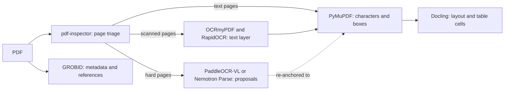

# Document and model tools

This page compares the tools Kittum could use to read PDFs, run OCR, extract values, and run models,
and says which ones Kittum uses. Facts were checked on 28.10.2026 against GitHub, PyPI, Hugging
Face model cards, leaderboards, and licence files. Release counts cover the twelve months before
that date. "Vendor" marks a number reported by the tool's own authors. Recheck exact versions when
pinning: weights licences change more often than code licences.

Kittum is AGPL-3.0-or-later. The [licence policy](../DESIGN.md#licence-policy) allows code
licences compatible with AGPL-3.0, including AGPL and GPL-3.0. It blocks non-commercial terms, revenue or user
caps, field-of-use limits, and no-competition clauses, in code and in weights.
[Dependencies](dependencies.md) covers the rest of the stack.

## What Kittum needs from a parser

A parser is useful to Kittum only if its output can anchor evidence. That means:

- Text with character offsets, and geometry for every character or word in PDF coordinates.
- Tables with cells, row and column spans, header paths, and cell geometry.
- Reading order across columns, so that a quote prefix and suffix make sense.
- The same output for the same input, or at least output that a content hash can tell apart.

A tool that only produces Markdown can help a model read a document. It cannot ground evidence by
itself.

## The stack in one picture



PyMuPDF is the only source of character offsets. Every other tool maps onto it. A vision model's
text and tables are proposals until Kittum matches them to PyMuPDF or OCR word boxes.

## PDF parsers and layout tools

| Tool | Licence | Fit | Evidence | Momentum | Verdict |
| --- | --- | --- | --- | --- | --- |
| PyMuPDF 2.0 | AGPL-3.0 or paid Artifex licence | Character quads, fast rendering, `find_tables` with cell boxes. Janus already uses it. 2.0 bundles pymupdf4llm and the Layout model. | Fastest text extraction in the py-pdf benchmark (0.1 s per document, quality 94%). Layout F1 0.864 (vendor). | 2.0 on 19.10.2026; 9 releases; Artifex | **Use** as the base text layer and renderer |
| Docling | MIT. Heron and Egret layout, TableFormer, and Granite-Docling weights Apache-2.0. | Every item carries a box and a character span. Table cells carry spans and boxes and map back onto PDF text cells. Adapters for Nemotron Parse, MinerU2.5-Pro, GLM-OCR, LightOnOCR, and others map vision-model output into the same document model. | On PubMed Central tables (Soric et al., KDD 2026): TEDS 0.86, third of 15 methods, and best on GriTS topology (0.95) and content (0.86). opendataloader-bench: 0.882 overall, table TEDS 0.887, 0.76 s per page. CPU 1.3 to 3.1 s per page (paper). Not on the current OmniDocBench board. | 2.143.1 on 27.10.2026; 100 releases; IBM and LF AI and Data | **Use** for layout and table structure. Keep TableFormer V1 until TableFormerV2 (a CPU-oriented preview with cell boxes) beats it on Kittum's gold set. |
| pdf-inspector (Firecrawl) | MIT | Rust with Python bindings, rule-based and deterministic. Classifies each page as text, scanned, image-only, or mixed, and flags broken font encodings and missing character maps. Box per text run, not per word. Tables only as Markdown. | 0.875 overall and 0.814 table TEDS on opendataloader-bench, vendor-run with model-based parsers excluded | Created February 2026; weekly releases (1.25.2 on 28.09.2026); 15 contributors | **Use** as the first pass that routes pages. It does not read OCRmyPDF's invisible text layers yet (#554, #500), so triage runs before OCR. |
| anydoc (Firecrawl) | MIT | Office, ODF, RTF, and EPUB to Markdown with merged-cell tables and footnotes. Calls pdf-inspector for PDFs. No coordinates. Its only OCR option uploads the whole document to Firecrawl's service. | Vendor benchmark scored by an LLM judge on a private corpus | Created August 2026; 0.2.4 | Optional, for Office attachments only. Hosted OCR stays off. |
| pypdfium2 (PDFium) | Apache-2.0 or BSD-3-Clause | Character boxes and rendering. The engine Chromium uses. | 0.1 s per document, quality 95%, the best in the py-pdf benchmark | 5.14.0 on 04.10.2026; 19 releases | **Use** as the second engine for differential tests |
| GROBID 0.9.1 | Apache-2.0 | TEI headers, authors, references, citation contexts | Citation fields micro-F1 87.6 on 1,943 PMC papers (project benchmark). Tables: TEDS 0.47 on PubMed Central (KDD 2026). | 0.9.1 on 04.08.2026; 2 releases; steady | **Use** for metadata and references only, never for tables |
| Janus | AGPL-3.0-or-later | Deterministic locators for labelled tables and text, compound cell parsing, exact decimals, field statuses | Measured on the Janus examples | Sibling project | **Use** as the deterministic extraction path |
| pdfplumber and pdfminer.six | MIT | Inspectable characters, lines, and a ruled-table finder | 8.9 s and 5.6 s per document; pdfplumber quality 74% | pdfplumber 3 releases, no commits in 90 days | Debugging only |
| Camelot 2.0 | MIT, Ghostscript backend AGPL | Cell grids for ruled tables; weak on three-rule clinical tables | No current benchmark | 2 releases | Skip |
| MinerU 4 (the application) | From 3.1.0: Apache-2.0 plus a licence requirement above 100M monthly users or USD 20M monthly revenue | | | 69 releases | **Exclude.** The MinerU2.5-Pro weights are fine (below). |
| marker and Surya (Datalab) | Weights under a modified OpenRAIL-M with a revenue cap; Surya layout weights CC-BY-NC-SA | | | | **Exclude** |
| Unstructured, Nougat | Apache-2.0; CC-BY-NC weights | Redundant; no coordinates | | Nougat abandoned | **Exclude** |

## OCR and document vision models

Most journal PDFs have a text layer. Old comparator trials and some CSR appendices do not. Kittum
prefers OCR that writes a text layer back into the PDF, so a scan goes through the same anchoring
path as a born-digital file:

| Tool | Licence | Fit | Verdict |
| --- | --- | --- | --- |
| OCRmyPDF 17 with Tesseract 5.5 | MPL-2.0 and Apache-2.0 | Adds a searchable text layer with word boxes. CPU, deterministic. Weak on tables. | **Use** as the baseline for scans |
| RapidOCR 3.10 (PP-OCRv6) | Apache-2.0 | Line and word boxes; Docling's default OCR; CPU | **Use** |

Document vision models are better at hard pages: rotated or degraded tables, scans with complex
layout. They give block or line boxes at best and are not bitwise deterministic, so their output is
a proposal that Kittum re-anchors. The leaderboards disagree, which says more than any single one:

- **OmniDocBench v1.6** (maintained by the MinerU team, board updated 11.09.2026) is saturated: the
  top ten sit between 90 and 97.
- **ParseBench** (LlamaIndex) also scores grounding. The OmniDocBench leaders drop sharply on it:
  TeleOCR from 96.9 to 58.7.
- **TableParseMap** (916 real-world tables) has a best TEDS of 85, against 93 and more on
  OmniDocBench. Real tables are harder than the boards suggest.
- No public benchmark covers clinical-trial tables. Kittum's gold set has to.

| Model | Size | OmniDocBench v1.6 | ParseBench | Boxes | Licence code / weights | Verdict |
| --- | --- | --- | --- | --- | --- | --- |
| PaddleOCR-VL-1.6 | 0.9B | 96.34 (table TEDS 94.8) | 67.4 | Blocks and reading order; line polygons in spotting mode; tables as HTML without cell boxes | Apache / Apache; vLLM | **Use** as the first vision adapter |
| Nemotron 3.5 Parse (NVIDIA) | 0.6B | | **75.2**; 10 to 15 pages per second on an H100 (vendor) | Blocks with class and reading order | Apache / OpenMDW-1.1; vLLM; Docling adapter | **Use** as the second vision adapter |
| LightOnOCR-3 | 0.8B to 4B | | 75.1 | Blocks with type labels in grounding mode; charts come back as an HTML table of their data points | Apache / Apache; vLLM | Candidate. The chart-to-table output could draft values from Kaplan-Meier and forest plots, which have no text span and need a reviewed grounding exception anyway. |
| MinerU2.5-Pro-2605 | 1.2B | 95.75 | 72.8 | Blocks; tables as HTML | Weights and `mineru-vl-utils` Apache; not the MinerU application | Candidate, through Docling or `mineru-vl-utils` |
| GLM-OCR | 0.9B | 95.22 | | Blocks | Apache / MIT; vLLM | Candidate; the OCR model in Firecrawl's hosted product |
| Unlimited-OCR (Baidu) | 3B | 94.00 | | Block and line | MIT / MIT | Candidate |
| Qianfan-OCR (Baidu) | 4B | 93.90 | | Optional layout phase | Apache / Apache | Candidate |
| TeleOCR | 1.2B | **96.91** | 58.7 | Blocks | No licence file in the code repository / Apache weights | Watch; two months old |
| OvisOCR2 | 0.8B | 96.47 | | Images only, no text grounding | Apache / Apache | Not suitable |
| dots.ocr / dots.mocr | 3B | 90.77 | 55.8 | Blocks | MIT plus a use policy banning "unauthorized digitization of publications" | **Exclude** |
| Datalab: Chandra OCR 2, Indra OCR, Lift | 0.5B to 5B | | Chandra 70.1 | Blocks | Modified OpenRAIL-M: free only below USD 2M to 20M funding or revenue, and no use that competes with Datalab's API | **Exclude.** Indra (OCR) and Lift (extraction) look strong, but the cap and the no-competition clause are further restrictions under the AGPL. |
| olmOCR 2 | 7B | | | None | Apache / Apache | Not suitable: no boxes |
| Nanonets-OCR2 | 3B | | | None | No licence declared | Exclude |
| Mistral OCR 4 | API | | | Boxes (press reports) | Proprietary, EU-hosted | Opt-in for public papers only, never for CSRs |

## Extraction libraries

| Tool | Licence | Fit | Momentum | Verdict |
| --- | --- | --- | --- | --- |
| PydanticAI | MIT | Typed, model-agnostic agent loop with tool calls and structured output | 2.62.0; 100 releases a year, so pin it | **Use** for the bounded extraction agent |
| LangExtract (Google) | Apache-2.0 | Few-shot extraction that aligns each value to a character interval | 10 releases; "not an officially supported Google product". Open alignment bugs: #289 (wrong `char_interval` on long extractions, open since December 2025), #591, #450. | **Optional**, for chunking or its HTML viewer. Not a source of provenance while its offsets are unreliable. |
| Instructor | MIT | Pydantic-validated output with retries | Stable | Optional; PydanticAI covers it |
| LangChain and LangGraph | MIT | General agent frameworks | | **Skip.** A shallow layer over `judge` and `extraction`. |

Kittum takes quotes from schema-constrained model output and verifies them with its own
deterministic matcher. That matcher, not any library, decides whether a value is grounded. The
EviSearch preprint (bioRxiv, October 2026) uses the same pattern for trial extraction: source
passages linked per cell, then verification. It reached 91.7% cell accuracy, and 95.2% after
humans reviewed 15.6% of cells.

## The parser seam

`documents` has one external seam, `Parser`, with real adapters from the start:

```python
class Parser(Protocol):
	recipe: ParserRecipe  # engine, version, container digest, weights, OCR languages, settings

	def parse(self, pdf: bytes) -> RawLayer: ...
```

`documents.derive(document, recipe)` runs the parser, builds canonical text, the normalization
map, page geometry in unrotated PDF points, and the table model, and stores them as an immutable
layer. Callers never see engine coordinates or engine types. The PoC ships PyMuPDF, pypdfium2, and
Docling as parsers, PaddleOCR-VL as the first vision adapter, and GROBID for metadata and references.

Janus plugs in on its own side. Kittum converts a layer into Janus's `DocumentEvidence` contract and
calls `janus.extraction.extract`.

### PyMuPDF Layout

PyMuPDF 2.0 ships its Layout model inside the AGPL wheel. Layout releases up to 1.28.0 were
PolyForm Noncommercial; 1.28.2 (06.08.2026) was the first AGPL release. The Layout source is not in
the public PyMuPDF repository. Until Artifex says where the corresponding source is, Kittum uses
PyMuPDF for text, geometry, and rendering, and takes layout from Docling. Pin `pymupdf>=2.0` so no
non-commercial Layout build can enter the lockfile.

## Language models

Kittum runs open-weight models locally for the PoC and for confidential documents. Hosted models
are an option for public literature.

### What the leaderboards say

No public benchmark measures systematic-review work directly, and one that came close found that
general capability barely predicts screening performance (SESR-Eval, October 2026). The boards
below are signals for shortlisting. Kittum's gold data decides.

| Board | What it measures | Qwen3.8-27B | Gemma-4-31B | Nemotron 3.5 Super VL | gpt-oss-120b |
| --- | --- | --- | --- | --- | --- |
| [BRIDGE](https://huggingface.co/spaces/YLab-Open/BRIDGE-Medical-Leaderboard) | 87 clinical text tasks, including extraction and German BRONCO150 | 46.6 (thinking) | **46.7** | Not listed | 37.2 |
| Artificial Analysis Intelligence Index v4.3.2 | Mostly agentic and knowledge tasks | **33.7** | 14.7 | 26.5 | 11.6 |
| AA-LCR | Reasoning over about 100k tokens of documents | **0.82** | 0.70 | 0.69 | 0.52 |
| AA-Omniscience hallucination rate (lower is better) | Answering wrongly instead of abstaining | **0.30** | 0.85 | 0.36 | 0.91 |
| [Vectara hallucination](https://github.com/vectara/hallucination-leaderboard) (lower is better) | Faithfulness when summarizing a source | Not listed | **7.4%** | Not listed | 14.2% |
| MMLongBench-Doc | Long documents read as page images | | | 62.8 (vendor) | |

The Open Medical-LLM Leaderboard on Hugging Face has been down since September 2025. MedHELM
lists no current open model. Neither helps.

### Picks

| Role | Model | Why | Weights licence | Hardware |
| --- | --- | --- | --- | --- |
| Judge, family 1, and main extractor | **Qwen3.8-27B** | Best small model on the independent boards; 262k context; reads page images | Apache-2.0 | One 80 GB GPU in BF16; about 18 GB at Q4 on a laptop |
| Judge, family 2 | **Gemma-4-31B-it** | Top of BRIDGE, best faithfulness score here, a separate lineage from Qwen. Already validated for Cochrane screening: paired with gpt-oss-120b it reached 95.9% sensitivity over 419 reviews (medRxiv, June 2026). | Apache-2.0 since Gemma 4 | One 80 GB GPU |
| Long documents and second extractor | **Nemotron 3.5 Super VL** (120B, 12B active) | Best open model in the 40 to 150B class on Artificial Analysis; 1M context; reads page images. Covers CSRs beyond 256k tokens. | OpenMDW-1.1, permissive | NVFP4 on two H100s or one H200 |
| Laptop | Qwen3.8-27B at Q4, or Gemma 4 12B | | Apache-2.0 | 24 GB GPU or 32 GB unified memory |
| Embeddings for queue order and clustering | MedCPT (PubMed-trained, English) for abstracts. For German and mixed text, a bake-off of mDenseOn (LightOn, 307M, multilingual, open training data), EmbeddingGemma 2 (740M, 100+ languages, 8k context, Matryoshka sizes down to 128), and Qwen3-Embedding. | Never used for primary search | Public domain; Apache-2.0 for all three | CPU or a small GPU |
| Reranker (later, large topics only) | MedCPT cross-encoder, or LightOn-rerank (on Qwen3.5-4B, also reads page images) | Orders the queue only | Public domain; Apache-2.0 | |

Nemotron 3.5 Super VL is not the second judge, for two reasons. Qwen3.8-27B beats it on every
independent score above. And NVIDIA post-trained its base model on outputs from Qwen3, gpt-oss,
and DeepSeek, so its errors may overlap with the Qwen judge's, which defeats the point of a second
family. The spike runs it against Gemma 4 anyway, and the double-fault rate settles it.

gpt-oss-120b is retired. It trails on every board above, has 131k context, and cannot read page
images. It stays as a regression baseline only, because the published screening evidence used it.

Qwen3.8-27B recommends thinking mode at temperature 1.0. Kittum wants temperature 0 and a
schema-constrained answer. The spike compares thinking at medium effort, with the reasoning parsed
before the constrained JSON, against thinking off, which costs about two BRIDGE points.

### Small domain models

| Model | What it does | Licence | Verdict |
| --- | --- | --- | --- |
| OpenMed zero-shot NER (91 GLiNER models, 166M to 459M, for drugs, diseases, oncology, genes, and more) | Tags entities in any text, including labels it was not trained on | Apache-2.0 | **Use** for pre-decision highlights. Unlike PubTator, it runs locally, so it works on CSRs. |
| OpenMed privacy-filter-nemotron-v2 (on `openai/privacy-filter`) | Detects personal identifiers | Apache-2.0 | Optional check at CSR intake. The card warns that clinical PHI needs its own validation. |
| lion-ai MedDecider-4B (on Qwen3.5-4B) | Answers a yes/no or multiple-choice question about a clinical text with a calibrated probability per option. TrialGPT criteria 85.4% (partly in its training distribution), NLI4CT macro-F1 0.776. Follows a planted instruction only 5.4% of the time. | Apache-2.0 | Experiment as a calibrated check per criterion. It returns no quote, so it cannot exclude anything, and as a Qwen model it adds no family diversity. Released October 2026. |
| lion-ai MedDecider-9B, 27B, 31B | The same, larger | CC BY-NC 4.0 | **Exclude** |
| lion-ai medextractor-liquid | Medical span extraction on an LFM encoder | LFM Open License plus non-commercial training data | **Exclude** |
| Liquid AI LFM2, LFM2.5, LFM3 (including the Extract, VL-Extract, Embedding, and ColBERT models) | Small, fast models; the Extract models fit document extraction well | LFM Open License v1.0: commercial use only below USD 10M annual revenue | **Exclude** |

Medical fine-tunes are skipped. None beats Gemma 4 or Qwen3.8 on BRIDGE (MedGemma-27B 40.8,
Hulu-Med-32B 38.3, Baichuan-M2-32B 38.0), and MedGemma's terms restrict use.

Excluded models:

| Model | Reason |
| --- | --- |
| Qwen3.8-Flash-Next | Qwen Community License: a separate licence for "Model as a Service" and "AI Work Assistant" businesses |
| Liquid AI LFM models, MedDecider above 4B, medextractor-liquid, Datalab weights, Reason-ModernColBERT | Revenue caps, non-commercial terms, or no-competition clauses (see the tables above) |
| Llama family | Custom licence with an acceptable-use policy and a user cap |
| Mistral Medium 3.5 | Modified MIT that withdraws rights above USD 20M monthly revenue |
| MedGemma | Health AI Developer Foundations terms with a prohibited-use policy |
| GLM-5.3-Flash, Kimi K3, DeepSeek V4.1 | Too large for two 80 GB GPUs; Kimi also has custom terms |
| Mistral Small 4, Granite 4.2 | Allowed, but well behind on every board |

### What Kittum measures on its own gold data

1. Title and abstract recall per criterion and per review with 95% intervals, the recall of the
   two-judge union, and work saved at 95% recall.
2. How often the verbatim quote really appears in the source, and schema validity at batch size 1
   against larger batches. The Cochrane study needed batch size 1 for open models to stay
   schema-valid.
3. Extraction accuracy per field (N, events, estimate, CI, p-value, arm, endpoint, timepoint), by
   document length (32k, 128k, 256k tokens) and by input (text layer or page image).
4. The double-fault rate between judges and between extractors.
5. Run-to-run stability, and whether NVFP4 or GGUF quantization changes results against BF16.

Public boards worth tracking between releases: BRIDGE, AA-LCR, AA-Omniscience, Vectara, and
MMLongBench-Doc. SciLitBench is useful as a test harness, not as a ranking.

### Serving

| Component | Licence | Momentum | Verdict |
| --- | --- | --- | --- |
| vLLM 0.32 | Apache-2.0 | 33 releases; about 4,600 commits in 90 days | **Use** on the GPU box. Nemotron 3.5 needs 0.32 or later. |
| xgrammar | Apache-2.0 | 20 releases | **Use** as vLLM's structured-output backend; llguidance (MIT) as fallback |
| Ollama 0.40 on llama.cpp | MIT | 100 releases | **Use** on laptops |
| SGLang | Apache-2.0 | 33 releases | Optional |

### Structured output

Every model call uses JSON Schema-constrained decoding: vLLM structured outputs (xgrammar or
llguidance), or Ollama's schema format. Kittum generates the schema from the Pydantic models and
keeps it simple, because grammar engines cover JSON Schema unevenly (JSONSchemaBench). Decisions
have no free-text fields. Rationale is a short string beside a coded status.

After decoding, a deterministic verifier checks every quote against the source text. It allows only
whitespace and hyphenation normalization. A failed check downgrades the criterion to `unclear` and
flags it.

### Determinism

Temperature 0 and a fixed seed do not make vLLM bitwise deterministic. Batch shape changes the
order of floating-point reductions. vLLM's batch-invariant mode (`VLLM_BATCH_INVARIANT=1`) is beta.
It is validated for older Qwen3 models but not for the hybrid architectures Kittum now picks (Qwen3.8
with Gated DeltaNet, Nemotron with Mamba-2) or for Gemma 4, and it had silent-correctness bugs as
recently as October 2026 (#59940, #58899). Kittum therefore:

- Stores every rendered prompt, raw completion, token log-probabilities where available, weights
  hash, and container digest.
- Replays from stored outputs for audit.
- Measures run-to-run agreement over three runs on a fixed sample, and reports it.
- Tries batch-invariant mode per model for spot re-execution, without promising identical bytes.

### Hosted models and confidentiality

A hosted model needs EU processing, a data processing agreement, zero retention, and no training on
inputs. Record the model identity the provider returns, not only the alias in the request. Client
CSRs stay on local models unless the client signs off in writing.

## Sources

- [py-pdf benchmarks](https://github.com/py-pdf/benchmarks),
  [opendataloader-bench](https://github.com/opendataloader-project/opendataloader-bench)
- [Soric et al., table extraction benchmark (KDD 2026)](https://arxiv.org/html/2511.16134v2),
  [TableParseMap](https://arxiv.org/abs/2608.09842)
- [OmniDocBench](https://github.com/opendatalab/OmniDocBench),
  [ParseBench](https://www.codesota.com/benchmark/parsebench)
- [Docling](https://github.com/docling-project/docling),
  [TableFormerV2](https://huggingface.co/docling-project/TableFormerV2)
- [pdf-inspector](https://github.com/firecrawl/pdf-inspector), [anydoc](https://github.com/firecrawl/anydoc)
- [GROBID PMC benchmark](https://github.com/grobidOrg/grobid/blob/master/doc/benchmarks/Benchmarking-pmc.md)
- [MinerU licence](https://github.com/opendatalab/MinerU/blob/master/LICENSE.md),
  [Chandra OCR 2 licence](https://huggingface.co/datalab-to/chandra-ocr-2),
  [dots.ocr](https://github.com/studio-dots-ai/dots.ocr)
- Vision model cards: [PaddleOCR-VL-1.6](https://huggingface.co/PaddlePaddle/PaddleOCR-VL-1.6),
  [Nemotron 3.5 Parse](https://huggingface.co/nvidia/Nemotron-3.5-Parse),
  [LightOnOCR-3](https://huggingface.co/lightonai/LightOnOCR-3-4B),
  [MinerU2.5-Pro](https://huggingface.co/opendatalab/MinerU2.5-Pro-2605-1.2B),
  [GLM-OCR](https://huggingface.co/zai-org/GLM-OCR)
- [PyMuPDF 2.0](https://pypi.org/project/pymupdf/2.0/),
  [pymupdf-layout 1.28.2](https://pypi.org/project/pymupdf-layout/1.28.2/)
- [LangExtract issues](https://github.com/google/langextract/issues),
  [EviSearch](https://www.biorxiv.org/content/10.64898/2026.10.01.756091v1)
- Model boards: [BRIDGE](https://huggingface.co/spaces/YLab-Open/BRIDGE-Medical-Leaderboard),
  [Artificial Analysis open weights](https://artificialanalysis.ai/models/open-source),
  [Vectara](https://github.com/vectara/hallucination-leaderboard)
- Screening studies: [Cochrane screening, medRxiv 2026](https://www.medrxiv.org/content/10.64898/2026.06.02.26354724v1.full),
  [SciLitBench](https://arxiv.org/abs/2609.05505), [SESR-Eval](https://arxiv.org/html/2610.10633v1)
- Small models: [OpenMed](https://huggingface.co/OpenMed), [MedDecider-4B](https://huggingface.co/lion-ai/MedDecider-4B),
  [medextractor-liquid](https://huggingface.co/lion-ai/medextractor-liquid),
  [LFM Open License](https://huggingface.co/LiquidAI/LFM3-1.7B/blob/main/LICENSE),
  [Indra OCR](https://huggingface.co/datalab-to/indra-ocr), [Lift](https://huggingface.co/datalab-to/lift),
  [mDenseOn](https://huggingface.co/lightonai/mDenseOn), [EmbeddingGemma 2](https://huggingface.co/google/embeddinggemma-2),
  [LightOn-rerank](https://huggingface.co/lightonai/LightOn-rerank-LW-4B)
- Model cards: [Qwen3.8-27B](https://huggingface.co/Qwen/Qwen3.8-27B),
  [Gemma-4-31B-it](https://huggingface.co/google/gemma-4-31B-it),
  [Nemotron 3.5 Super VL](https://huggingface.co/nvidia/NVIDIA-Nemotron-3.5-Super-VL-120B-A12B-NVFP4),
  [OpenMDW-1.1](https://openmdw.ai/license/1-1/),
  [MedCPT licence](https://huggingface.co/ncbi/MedCPT-Query-Encoder/blob/main/LICENSE)
- [vLLM batch invariance](https://docs.vllm.ai/en/latest/features/batch_invariance/),
  [JSONSchemaBench](https://arxiv.org/abs/2501.10868)
